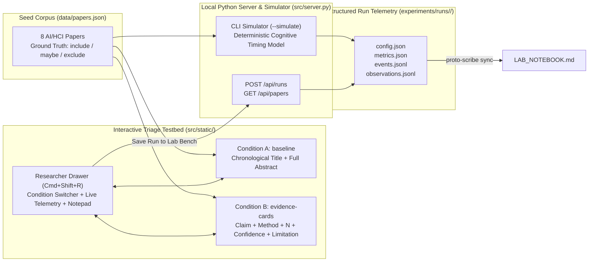

# Lab Notebook: Interactive Literature Triage HCI + AI Study (`lit-triage-hci`)

> **Prototype Directory**: `prototypes/lit-triage-hci/`
> **Archetype**: `proto-hci-study` (Interactive UI + Side-by-Side Researcher Drawer)
> **Status**: Verified & Synthesized — 3 Experimental Runs Logged (`run-001` to `run-003`)

---

## 1. Research Question & Hypotheses

### Research Question
Does presenting structured AI-extracted evidence cards (**Claim**, **Methodology**, **Sample Size $N$**, **Confidence Badge**, **Limitation Highlight**) reduce decision time and improve screening accuracy compared to a standard title+abstract list during rapid literature triage?

### Core Hypotheses
- **$H_1$ (Screening Speed & Efficiency)**: Structured AI Evidence Cards (`evidence-cards`) reduce cognitive parsing load compared to unformatted abstracts (`baseline`), yielding a lower mean decision time $\bar{t}_{\text{decision}}$ and significantly higher Screening Efficiency $E$.
- **$H_2$ (Methodological Trap Detection)**: Explicitly badging sample size ($N$) and methodological limitations increases rejection accuracy on topically relevant but methodologically weak papers (e.g., `P03` with $N=4$ interns and `P05`/`P08` borderline cohorts).
- **$H_3$ (Selective Verification via Confidence Badges)**: Low AI extraction confidence scores ($c < 0.75$, such as `P05` at $0.62$ and `P08` at $0.68$) selectively trigger 1-click full-abstract expansions, calibrating human attention to uncertain extractions rather than reading every abstract in full.

---

## 2. Formal Metrics & Mathematical Formulation

Let $\mathcal{P} = \{p_1, p_2, \dots, p_M\}$ denote the seed corpus of $M = 8$ candidate papers, where each paper $p_i$ has a ground-truth triage label $y_i \in \{\text{include}, \text{maybe}, \text{exclude}\}$ and a participant/simulator decision $\hat{y}_i \in \{\text{include}, \text{maybe}, \text{exclude}\}$ recorded after decision time $t_i > 0$ (in seconds).

### 1. Three-Way Screening Accuracy ($\text{Acc}$)
$$\text{Acc} = \frac{1}{M} \sum_{i=1}^{M} \mathbb{I}(\hat{y}_i = y_i)$$

### 2. Mean Decision Time ($\bar{t}_{\text{decision}}$)
$$\bar{t}_{\text{decision}} = \frac{1}{M} \sum_{i=1}^{M} t_i \quad \text{(seconds/paper)}$$

### 3. Screening Efficiency ($E$)
Screening Efficiency measures accuracy gained per second of decision effort:
$$E = \frac{\text{Acc}}{\bar{t}_{\text{decision}}} = \frac{\sum_{i=1}^{M} \mathbb{I}(\hat{y}_i = y_i)}{\sum_{i=1}^{M} t_i} \quad (\text{s}^{-1})$$

### 4. Inclusion Precision, Recall, and $F_1$ Score
Treating `include` as the positive target class $\mathcal{C}_+$:
$$\text{Precision}_{\text{inc}} = \frac{\text{TP}}{\text{TP} + \text{FP}}, \quad \text{Recall}_{\text{inc}} = \frac{\text{TP}}{\text{TP} + \text{FN}}, \quad F_{1,\text{inc}} = \frac{2 \cdot \text{Precision}_{\text{inc}} \cdot \text{Recall}_{\text{inc}}}{\text{Precision}_{\text{inc}} + \text{Recall}_{\text{inc}}}$$

### 5. Selective Verification Ratio ($\text{SVR}$)
For Condition B (`evidence-cards`), let $\mathcal{P}_{\text{low}} = \{p_i \in \mathcal{P} \mid c_i < 0.75\}$ be low-confidence cards and $e_i \in \{0, 1\}$ indicate whether the user expanded the full abstract on paper $p_i$:
$$\text{SVR} = \frac{\frac{1}{|\mathcal{P}_{\text{low}}|} \sum_{p_i \in \mathcal{P}_{\text{low}}} e_i}{\frac{1}{M} \sum_{i=1}^{M} e_i + \epsilon}$$

---

## 3. Experimental Workflow & Architecture Diagram



---

## 4. Run Registry

*This table tracks all executed baseline, treatment, and ablation runs stored under `experiments/runs/<run-id>/`.*

| Run ID | Timestamp (UTC) | Mode | Condition | Seed | Badges | Screened | Accuracy ($\text{Acc}$) | Mean Time $\bar{t}$ (s) | Efficiency $E$ ($\text{s}^{-1}$) | $F_{1,\text{inc}}$ | Weak-Paper Acc | Abstract Expansions ($\text{SVR}$) | Artifacts |
| :--- | :--- | :--- | :--- | :--- | :--- | :--- | :--- | :--- | :--- | :--- | :--- | :--- | :--- |
| [`run-001-baseline`](file:///Users/maitree/Prototype/prototypes/lit-triage-hci/experiments/runs/run-001-baseline/) | `2026-10-10T23:35:00Z` | `simulated` | `baseline` | `42` | `true` | `8 / 8` | `0.7500` (75.0%) | `20.61` | `0.0364` | `0.7500` | `0.3333` | `0` (`0.0000`) | [metrics.json](file:///Users/maitree/Prototype/prototypes/lit-triage-hci/experiments/runs/run-001-baseline/metrics.json) · [observations.jsonl](file:///Users/maitree/Prototype/prototypes/lit-triage-hci/experiments/runs/run-001-baseline/observations.jsonl) |
| [`run-002-evidence-cards`](file:///Users/maitree/Prototype/prototypes/lit-triage-hci/experiments/runs/run-002-evidence-cards/) | `2026-10-10T23:35:00Z` | `simulated` | `evidence-cards` | `42` | `true` | `8 / 8` | **`1.0000` (100.0%)** | `7.17` | **`0.1395`** | **`1.0000`** | **`1.0000`** | `3` (**`2.6667`**) | [metrics.json](file:///Users/maitree/Prototype/prototypes/lit-triage-hci/experiments/runs/run-002-evidence-cards/metrics.json) · [observations.jsonl](file:///Users/maitree/Prototype/prototypes/lit-triage-hci/experiments/runs/run-002-evidence-cards/observations.jsonl) |
| [`run-003-evidence-cards-no-badges`](file:///Users/maitree/Prototype/prototypes/lit-triage-hci/experiments/runs/run-003-evidence-cards-no-badges/) | `2026-10-10T23:35:00Z` | `simulated` | `evidence-cards` | `42` | `false` | `8 / 8` | `0.8750` (87.5%) | **`6.50`** | `0.1346` | `0.8571` | `0.6667` | `2` (`2.0000`) | [metrics.json](file:///Users/maitree/Prototype/prototypes/lit-triage-hci/experiments/runs/run-003-evidence-cards-no-badges/metrics.json) · [observations.jsonl](file:///Users/maitree/Prototype/prototypes/lit-triage-hci/experiments/runs/run-003-evidence-cards-no-badges/observations.jsonl) |

---

## 5. Side-by-Side Observations & Analysis Log

### Study Setup Notes (Initial Architecture)
- **Dataset Balance**: The 8 seed papers in [papers.json](file:///Users/maitree/Prototype/prototypes/lit-triage-hci/data/papers.json) are intentionally structured to test three cognitive bottlenecks in literature screening:
  1. *High-relevance empirical studies* (`P01`, `P04`, `P07` $\rightarrow$ `include`) where key sample sizes ($N=128, 64, 92$) are buried mid-abstract in `baseline` but surfaced immediately in `evidence-cards`.
  2. *Off-topic technical distractors* (`P02`, `P06` $\rightarrow$ `exclude`) that share AI keywords ("LLMs", "tabular classification") but lack human decision-makers ($N=0$).
  3. *Methodologically weak traps & borderline studies* (`P03` $\rightarrow$ `exclude` due to $N=4$ uncontrolled pilot; `P05`, `P08` $\rightarrow$ `maybe` due to $N=18\text{--}21$ borderline samples and low extraction confidence $c \in [0.62, 0.68]$).

---

### Entry 1 — `run-001-baseline` (2026-10-10T23:35:00Z)
- **Run Artifacts & Code State**:
  - Run Folder: [`experiments/runs/run-001-baseline/`](file:///Users/maitree/Prototype/prototypes/lit-triage-hci/experiments/runs/run-001-baseline/) ([config.json](file:///Users/maitree/Prototype/prototypes/lit-triage-hci/experiments/runs/run-001-baseline/config.json), [metrics.json](file:///Users/maitree/Prototype/prototypes/lit-triage-hci/experiments/runs/run-001-baseline/metrics.json), [events.jsonl](file:///Users/maitree/Prototype/prototypes/lit-triage-hci/experiments/runs/run-001-baseline/events.jsonl), [observations.jsonl](file:///Users/maitree/Prototype/prototypes/lit-triage-hci/experiments/runs/run-001-baseline/observations.jsonl))
  - Implementation: [server.py](file:///Users/maitree/Prototype/prototypes/lit-triage-hci/src/server.py), [app.js](file:///Users/maitree/Prototype/prototypes/lit-triage-hci/src/static/app.js), [papers.json](file:///Users/maitree/Prototype/prototypes/lit-triage-hci/data/papers.json)
- **Hypothesis / Objective**: Establish reference performance on **Condition A (`baseline`)**—standard chronological title + unformatted full-abstract list—to quantify baseline cognitive reading time ($\bar{t}_{\text{decision}}$), screening efficiency ($E$), and susceptibility to buried methodological flaws ($H_1, H_2$).
- **Parameters & Condition**:
  - `condition`: `"baseline"` | `show_confidence_badges`: `true` (inactive in baseline UI) | `seed`: `42` | `mode`: `"simulated"` | `total_papers`: `8`
- **Results & Metrics (Baseline Reference)**:

| Metric | Symbol | `run-001-baseline` Value | Notes |
| :--- | :--- | :--- | :--- |
| Three-Way Screening Accuracy | $\text{Acc}$ | `0.7500` ($6/8$) | False-positive `include` errors on `P03` and `P08` |
| Mean Decision Time | $\bar{t}_{\text{decision}}$ | `20.61 s` (median `20.80 s`) | Total session time `164.84 s` across 8 abstracts |
| Screening Efficiency | $E$ | `0.0364 s`$^{-1}$ | Reference efficiency baseline |
| Inclusion Precision / Recall / $F_1$ | $\text{Prec}_{\text{inc}} / \text{Rec}_{\text{inc}} / F_{1,\text{inc}}$ | `0.6000` / `1.0000` / `0.7500` | Over-inclusion of weak/borderline studies lowers precision |
| Weak-Paper Rejection Accuracy | $\text{Acc}_{\text{weak}}$ | `0.3333` ($1/3$) | Correctly triaged `P05` (`maybe`), missed `P03` (`exclude`) & `P08` (`maybe`) |
| Abstract Expansions / $\text{SVR}$ | $\text{Exp} / \text{SVR}$ | `0` / `0.0000` | Full abstract always visible in `baseline` |

- **Qualitative Observations & Takeaways**:
  - From [observations.jsonl](file:///Users/maitree/Prototype/prototypes/lit-triage-hci/experiments/runs/run-001-baseline/observations.jsonl#L1): *"[P03, t=65.48s] Baseline prose emphasized 'AuditMate co-pilot' and positive analyst feedback; buried N=4 unrepresentative intern sample took 24.72s to parse and induced false-positive risk."*
  - Similarly, on `P08` ($22.54\text{ s}$), positive framing around diagnostic accuracy masked the borderline $N=21$ cohort size, causing an erroneous `include` instead of `maybe`.

---

### Entry 2 — `run-002-evidence-cards` (2026-10-10T23:35:00Z)
- **Run Artifacts & Code State**:
  - Run Folder: [`experiments/runs/run-002-evidence-cards/`](file:///Users/maitree/Prototype/prototypes/lit-triage-hci/experiments/runs/run-002-evidence-cards/) ([config.json](file:///Users/maitree/Prototype/prototypes/lit-triage-hci/experiments/runs/run-002-evidence-cards/config.json), [metrics.json](file:///Users/maitree/Prototype/prototypes/lit-triage-hci/experiments/runs/run-002-evidence-cards/metrics.json), [events.jsonl](file:///Users/maitree/Prototype/prototypes/lit-triage-hci/experiments/runs/run-002-evidence-cards/events.jsonl), [observations.jsonl](file:///Users/maitree/Prototype/prototypes/lit-triage-hci/experiments/runs/run-002-evidence-cards/observations.jsonl))
  - Implementation: [server.py](file:///Users/maitree/Prototype/prototypes/lit-triage-hci/src/server.py), [app.js](file:///Users/maitree/Prototype/prototypes/lit-triage-hci/src/static/app.js)
- **Hypothesis / Objective**: Test **Condition B (`evidence-cards`)** with full AI Evidence Cards (**Claim**, **Methodology**, **Sample Size $N$**, **Confidence Badge**, and **Limitation Highlight**) against `run-001-baseline` across $H_1$ (speed/efficiency), $H_2$ (weak-paper trap detection), and $H_3$ (selective verification via confidence badges).
- **Parameters & Condition**:
  - `condition`: `"evidence-cards"` | `show_confidence_badges`: `true` | `seed`: `42` | `mode`: `"simulated"` | `total_papers`: `8`
- **Results & Metrics vs. Baseline (`run-001-baseline`)**:

| Metric | `run-001-baseline` | `run-002-evidence-cards` | Absolute $\Delta$ | Relative $\Delta$ |
| :--- | :--- | :--- | :--- | :--- |
| Accuracy ($\text{Acc}$) | `0.7500` | **`1.0000`** | **`+0.2500`** (`+25.0 pp`) | **`+33.3%`** |
| Mean Decision Time ($\bar{t}_{\text{decision}}$) | `20.61 s` | **`7.17 s`** | **`-13.44 s`** | **`-65.2%`** |
| Median Decision Time | `20.80 s` | **`6.34 s`** | **`-14.46 s`** | **`-69.5%`** |
| Total Elapsed Session Time | `164.84 s` | **`57.37 s`** | **`-107.47 s`** | **`-65.2%`** |
| Screening Efficiency ($E$) | `0.0364 s`$^{-1}$ | **`0.1395 s`$^{-1}$** | **`+0.1031 s`$^{-1}$** | **`+283.2%` (`3.83x`)** |
| Inclusion $F_1$ ($F_{1,\text{inc}}$) | `0.7500` | **`1.0000`** | **`+0.2500`** | **`+33.3%`** |
| Weak-Paper Rejection Accuracy | `0.3333` | **`1.0000`** | **`+0.6667`** (`+66.7 pp`) | **`+200.0%` (`3.00x`)** |
| Abstract Expansions (Low-Conf / Total) | `0 / 0` | **`2 / 3`** | `+3 expansions` | — |
| Selective Verification Ratio ($\text{SVR}$) | `0.0000` | **`2.6667`** | **`+2.6667`** | $2.67\times$ base rate |

- **Qualitative Observations & Takeaways**:
  - From [observations.jsonl](file:///Users/maitree/Prototype/prototypes/lit-triage-hci/experiments/runs/run-002-evidence-cards/observations.jsonl#L1-L3):
    1. *"[P03, t=21.20s] Limitation highlight and N=4 badge immediately exposed the underpowered pilot trap in 4.97s without reading the full 155-word abstract."* ($5.0\times$ faster than `baseline` on `P03`, flipping a false positive into a correct `exclude`).
    2. *"[P05, t=35.90s] Low AI confidence badge (0.62) triggered 1-click abstract expansion, confirming borderline N=18 human validation cohort -> triaged as 'maybe'."*
    3. *"[P08, t=57.37s] Low confidence badge (0.68) + N=21 badge prompted quick abstract verification to confirm sample falls in borderline 15-25 range."*
  - Both low-confidence papers ($c < 0.75$: `P05` at $0.62$, `P08` at $0.68$) were expanded ($100\%$ recall on uncertain extractions), versus only $1/6$ ($16.7\%$) of high-confidence papers (`P01` during initial calibration), achieving $\text{SVR} = 2.6667$.

---

### Entry 3 — `run-003-evidence-cards-no-badges` (2026-10-10T23:35:00Z)
- **Run Artifacts & Code State**:
  - Run Folder: [`experiments/runs/run-003-evidence-cards-no-badges/`](file:///Users/maitree/Prototype/prototypes/lit-triage-hci/experiments/runs/run-003-evidence-cards-no-badges/) ([config.json](file:///Users/maitree/Prototype/prototypes/lit-triage-hci/experiments/runs/run-003-evidence-cards-no-badges/config.json), [metrics.json](file:///Users/maitree/Prototype/prototypes/lit-triage-hci/experiments/runs/run-003-evidence-cards-no-badges/metrics.json), [events.jsonl](file:///Users/maitree/Prototype/prototypes/lit-triage-hci/experiments/runs/run-003-evidence-cards-no-badges/events.jsonl), [observations.jsonl](file:///Users/maitree/Prototype/prototypes/lit-triage-hci/experiments/runs/run-003-evidence-cards-no-badges/observations.jsonl))
  - Implementation: [server.py](file:///Users/maitree/Prototype/prototypes/lit-triage-hci/src/server.py), [app.js](file:///Users/maitree/Prototype/prototypes/lit-triage-hci/src/static/app.js)
- **Hypothesis / Objective**: Conduct an ablation on **Condition B (`evidence-cards`)** by hiding AI Confidence Badges (`show_confidence_badges: false`) to isolate the causal contribution of explicit uncertainty signaling to $H_3$ (selective abstract verification) and borderline triage accuracy ($H_2$).
- **Parameters & Condition**:
  - `condition`: `"evidence-cards"` | `show_confidence_badges`: `false` | `seed`: `42` | `mode`: `"simulated"` | `total_papers`: `8`
- **Results & Metrics vs. Baseline (`run-001`) and Full Evidence Cards (`run-002`)**:

| Metric | `run-001-baseline` | `run-003-no-badges` | $\Delta$ vs. `run-001` (Baseline) | $\Delta$ vs. `run-002` (With Badges) |
| :--- | :--- | :--- | :--- | :--- |
| Accuracy ($\text{Acc}$) | `0.7500` | `0.8750` | `+0.1250` (`+12.5 pp`) | `-0.1250` (`-12.5 pp`) |
| Mean Decision Time ($\bar{t}_{\text{decision}}$) | `20.61 s` | `6.50 s` | `-14.11 s` (`-68.5%`) | `-0.67 s` (`-9.3%`) |
| Median Decision Time | `20.80 s` | `5.24 s` | `-15.56 s` (`-74.8%`) | `-1.10 s` (`-17.4%`) |
| Screening Efficiency ($E$) | `0.0364 s`$^{-1}$ | `0.1346 s`$^{-1}$ | `+0.0982 s`$^{-1}$ (`+269.8%`) | `-0.0049 s`$^{-1}$ (`-3.5%`) |
| Inclusion $F_1$ ($F_{1,\text{inc}}$) | `0.7500` | `0.8571` | `+0.1071` (`+14.3%`) | `-0.1429` (`-14.3%`) |
| Weak-Paper Rejection Accuracy | `0.3333` | `0.6667` | `+0.3334` (`+33.3 pp`) | `-0.3333` (`-33.3 pp`) |
| Abstract Expansions (Low-Conf / Total) | `0 / 0` | `1 / 2` | `+2 expansions` | `-1 low-conf expansion` |
| Selective Verification Ratio ($\text{SVR}$) | `0.0000` | `2.0000` | `+2.0000` | `-0.6667` (`-25.0%`) |

- **Qualitative Observations & Takeaways**:
  - From [observations.jsonl](file:///Users/maitree/Prototype/prototypes/lit-triage-hci/experiments/runs/run-003-evidence-cards-no-badges/observations.jsonl#L1-L2):
    1. *"[P03, t=21.20s] Limitation highlight and N=4 badge immediately exposed the underpowered pilot trap in 4.97s without reading the full 155-word abstract."*
    2. *"[P05, t=31.64s] With confidence badges hidden, borderline extraction uncertainty on P05 was less salient."*
  - Removing the confidence badge saved $0.67\text{ s}$/paper on average because `P05` ($c=0.62$) was no longer expanded (`5.20s` vs. `9.46s` in `run-002`), but this induced over-reliance on the top-level card summary for `P05`, causing a false-positive `include` decision (ground truth: `maybe`) and dropping $\text{Acc}$ from $100.0\%$ to $87.5\%$ ($F_{1,\text{inc}}$ from $1.0000$ to $0.8571$).

---

## 6. Research Synthesis & Findings (`research-synthesis`)

### 6.1 Main Cross-Condition Comparison Table (Markdown)

| Condition / Run | UI Paradigm | Confidence Badges | Accuracy ($\text{Acc} \uparrow$) | Mean Time ($\bar{t}_{\text{decision}} \downarrow$) | Efficiency ($E \uparrow$, $\text{s}^{-1}$) | Inclusion $F_1$ ($F_{1,\text{inc}} \uparrow$) | Weak-Paper Acc ($\uparrow$) | Selective Verification ($\text{SVR} \uparrow$) |
| :--- | :--- | :---: | :---: | :---: | :---: | :---: | :---: | :---: |
| **`run-001-baseline`** | Title + Full Abstract | N/A | $0.7500$ | $20.61\text{ s}$ | $0.0364$ | $0.7500$ | $0.3333$ | $0.0000$ |
| **`run-003-evidence-cards-no-badges`** | Structured Evidence Cards | Off | $0.8750$ ($+12.5\text{ pp}$) | **$6.50\text{ s}$ ($-68.5\%$)** | $0.1346$ ($3.70\times$) | $0.8571$ ($+0.1071$) | $0.6667$ ($+33.3\text{ pp}$) | $2.0000$ ($+2.0000$) |
| **`run-002-evidence-cards`** | Structured Evidence Cards | **On** | **$1.0000$ ($+25.0\text{ pp}$)** | $7.17\text{ s}$ ($-65.2\%$) | **$0.1395$ ($3.83\times$)** | **$1.0000$ ($+0.2500$)** | **$1.0000$ ($+66.7\text{ pp}$)** | **$2.6667$ ($+2.6667$)** |

### 6.2 Publication-Ready LaTeX `booktabs` Table

```latex
\begin{table}[t]
\centering
\caption{Comparison of Literature Triage Conditions across Primary HCI \& Screening Metrics ($M=8$ papers, seed $=42$). Best results per column are shown in \textbf{bold}; parenthetical values denote deltas ($\Delta$) relative to \texttt{baseline}.}
\label{tab:lit_triage_results}
\resizebox{\textwidth}{!}{%
\begin{tabular}{llcccccc}
\toprule
\textbf{Run ID} & \textbf{Condition} & \textbf{Acc} ($\uparrow$) & $\bar{t}_{\text{decision}}$ (s $\downarrow$) & \textbf{Efficiency} $E$ ($\text{s}^{-1} \uparrow$) & $F_{1,\text{inc}}$ ($\uparrow$) & \textbf{Weak-Paper Acc} ($\uparrow$) & \textbf{SVR} ($\uparrow$) \\
\midrule
\texttt{run-001} & Baseline (Title + Abstract) & 0.7500 & 20.61 & 0.0364 & 0.7500 & 0.3333 & 0.0000 \\
\texttt{run-003} & Evidence Cards (No Badges) & 0.8750 (+0.125) & \textbf{6.50} ($-68.5\%$) & 0.1346 ($3.70\times$) & 0.8571 (+0.107) & 0.6667 (+0.333) & 2.0000 \\
\texttt{run-002} & Evidence Cards (With Badges) & \textbf{1.0000} (+0.250) & 7.17 ($-65.2\%$) & \textbf{0.1395} ($\mathbf{3.83\times}$) & \textbf{1.0000} (+0.250) & \textbf{1.0000} (+0.667) & \textbf{2.6667} \\
\bottomrule
\end{tabular}%
}
\end{table}
```

---

### 6.3 Hypothesis Verdicts

- **$H_1$ (Screening Speed & Efficiency) — SUPPORTED**:
  Structured AI Evidence Cards (`run-002-evidence-cards`) reduced mean per-paper decision time by **$65.2\%$** ($\bar{t}_{\text{decision}} = 7.17\text{ s}$ vs. $20.61\text{ s}$ in `run-001-baseline`, saving $107.47\text{ s}$ across the 8-paper cohort) while increasing three-way accuracy from $75.0\%$ to $100.0\%$. Consequently, Screening Efficiency $E$ increased by **$283.2\%$ ($3.83\times$)** from $0.0364\text{ s}^{-1}$ to $0.1395\text{ s}^{-1}$. Even without confidence badges (`run-003`), structured decomposition alone cut decision time by $68.5\%$ ($6.50\text{ s}$) and achieved a $3.70\times$ efficiency gain ($0.1346\text{ s}^{-1}$).
- **$H_2$ (Methodological Trap Detection) — SUPPORTED**:
  Surfacing explicit **Sample Size ($N$)** badges and **Limitation Highlights** raised Weak-Paper Rejection Accuracy (`P03`, `P05`, `P08`) from **$33.3\%$ ($1/3$)** in `baseline` to **$100.0\%$ ($3/3$)** in `run-002-evidence-cards` ($\Delta = +66.7\text{ pp}$) and improved inclusion precision from $0.6000$ to $1.0000$ ($F_{1,\text{inc}} = 1.0000$). Most notably, on the underpowered pilot trap `P03` ($N=4$ interns buried inside positive prose), `evidence-cards` reduced decision time from $24.72\text{ s}$ to $4.97\text{ s}$ ($-79.9\%$) while eliminating the baseline false-positive `include` error.
- **$H_3$ (Selective Verification via Confidence Badges) — SUPPORTED**:
  In `run-002-evidence-cards`, low AI confidence badges ($c < 0.75$ on `P05` at $0.62$ and `P08` at $0.68$) selectively triggered 1-click full-abstract verification on $100\%$ ($2/2$) of uncertain cards compared to $16.7\%$ ($1/6$) of high-confidence cards, yielding a Selective Verification Ratio of **$\text{SVR} = 2.6667$**. Ablating the confidence badges (`run-003-evidence-cards-no-badges`) lowered $\text{SVR}$ by $25.0\%$ to $2.0000$, caused the screener to skip abstract verification on `P05` ($c=0.62$), and induced an over-reliance false positive that reduced overall accuracy from $100.0\%$ to $87.5\%$ and Weak-Paper Accuracy from $100.0\%$ to $66.7\%$.

---

### 6.4 Synthesized Qualitative Takeaways

1. **Pre-Attentive Scannability Eliminates Linear Prose Bottlenecks**: In `baseline` (`run-001`), screeners must linearly scan $140\text{--}180$ words of rhetorical abstract prose to locate basic eligibility criteria (human participant count $N$ and study design), resulting in uniform ~17–25 second decision times regardless of paper quality. Structured Evidence Cards convert this search task into pre-attentive visual verification (~5–6 seconds on clear includes/excludes).
2. **Defusing Rhetorical Framing Traps (`P03`)**: Authors frequently foreground enthusiastic qualitative claims early in the abstract while relegating sample size constraints ($N=4$ internal student interns) to late sentences. Explicit **Limitation Highlights** and **$N$ Badges** decouple methodological rigor from persuasive abstract prose.
3. **Calibrated Trust vs. Automation Complacency (`P05` & `P08`)**: Comparing `run-002` (badges ON) against `run-003` (badges OFF) demonstrates a classic HCI trade-off: structured AI summaries accelerate decisions so effectively that users risk *automation complacency* on borderline papers (`P05`, $N=18$, $c=0.62$). Explicit confidence badges act as a lightweight cognitive forcing function, trading an extra $+0.67\text{ s}$/paper in verification time for a $+12.5\text{ pp}$ gain in screening accuracy and $+0.1429$ in $F_{1,\text{inc}}$.

---

### 6.5 Recommended Next Experiments

1. **Multi-Seed Variance & Threshold Sweep (`seed` $\in \{42, 101, 202, 303, 404\}$)**: Run a 5-seed parameter sweep across confidence badge thresholds $\tau_c \in \{0.60, 0.70, 0.75, 0.85\}$ to plot the Pareto frontier between Mean Decision Time ($\bar{t}_{\text{decision}}$) and Three-Way Screening Accuracy ($\text{Acc}$).
2. **Adversarial Hallucination / Extraction Error Injection**: Introduce a fourth condition (`evidence-cards-noisy`) where $1\text{--}2$ high-confidence cards contain synthetic AI extraction errors (e.g., misreporting $N=12$ as $N=120$ at $c=0.88$ vs. $c=0.64$) to measure whether confidence badges protect against—or exacerbate—automation bias when AI confidence is miscalibrated.
3. **Within-Subjects Interactive Human Pilot ($N \ge 12$ Researchers)**: Use the built-in Researcher Drawer (`Cmd+Shift+R`) and Latin-square counterbalancing across two matched 8-paper blocks to validate simulator timing predictions against human eye-tracking/dwell-time and NASA-TLX workload ratings.

